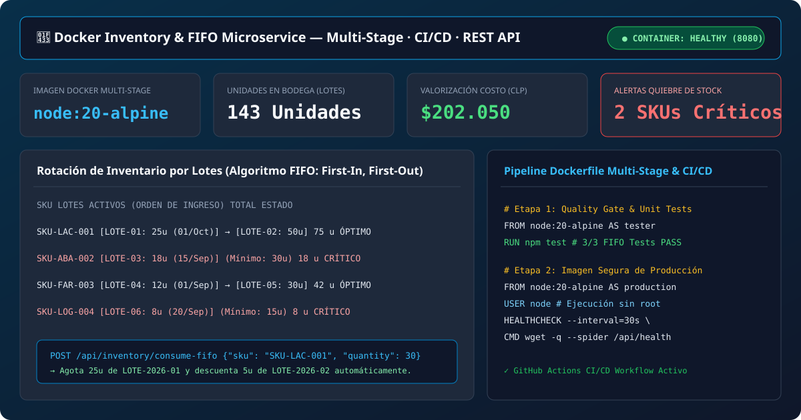
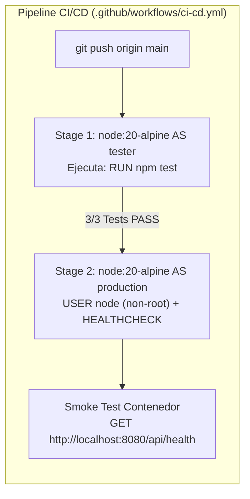
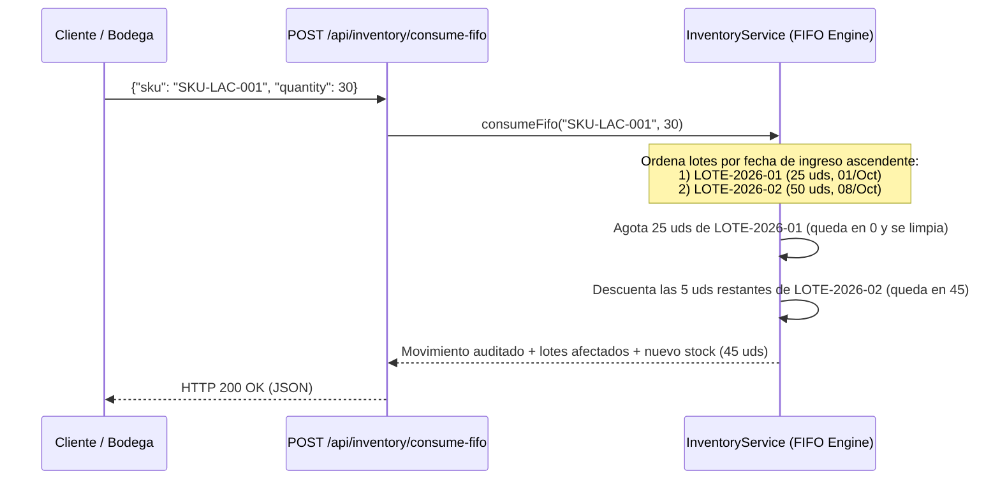

# 🐳 Docker Inventory & FIFO Microservice

[-2496ED?logo=docker&logoColor=white)](./Dockerfile)
[](./.github/workflows/ci-cd.yml)
[-22c55e)](./tests)
[](https://juancovili.github.io/docker-inventory-microservice/)

> Microservicio REST de **Control de Inventario, Rotación por Lotes (`FIFO: First-In, First-Out`), Alertas de Quiebre de Stock y Valorización Contable**, empaquetado mediante **Dockerfile Multi-Stage**, ejecución segura sin privilegios (`USER node`), monitoreo nativo (`HEALTHCHECK`), orquestación con `docker-compose` y pipeline `CI/CD` en **GitHub Actions**.

🔗 **[Probar Consola Interactiva del Microservicio en Vivo (GitHub Pages)](https://juancovili.github.io/docker-inventory-microservice/)**



---

## 🏗️ Pipeline de Contenerización Multi-Stage & CI/CD

El [`Dockerfile`](./Dockerfile) implementa dos etapas aisladas para garantizar que ninguna imagen de producción se construya si falla una prueba unitaria del algoritmo FIFO:



### Flujo de Extracción por Lotes (`Algoritmo FIFO`)



---

## 🧪 Suite de Pruebas Automatizadas ([`/tests`](./tests))

Las pruebas unitarias se encuentran en [`/tests/inventory.test.js`](./tests/inventory.test.js) y se ejecutan sin dependencias pesadas mediante el runner nativo `node:test`:

| # | Caso de Prueba | Qué verifica | Estado |
| :--- | :--- | :--- | :---: |
| **1** | `Calcula correctamente el stock total por lotes y detecta alertas críticas` | Suma de lotes por SKU, valorización contable a costo/venta y detección de SKUs con `totalStock < minStock`. | ✅ PASS |
| **2** | `Consume unidades respetando estrictamente el orden FIFO` | Descuento multi-lote: al pedir 30 uds cuando el lote más antiguo tiene 25 uds, consume las 25 del primer lote y 5 del segundo. | ✅ PASS |
| **3** | `Lanza excepción cuando el stock es insuficiente` | Prevención de quiebre negativo de inventario (`Stock insuficiente`). | ✅ PASS |

```bash
# Ejecutar pruebas localmente
npm test
```

---

## 📡 Endpoints de la API REST

| Método | Ruta | Descripción |
| :--- | :--- | :--- |
| `GET` | `/api/health` | Estado de salud del contenedor (`UP`), hostname, arquitectura y uptime. |
| `GET` | `/api/inventory` | Catálogo completo con lotes FIFO activos, valorización y métricas. |
| `GET` | `/api/inventory/alerts` | Lista filtrada de SKUs en estado de **Stock Crítico**. |
| `POST` | `/api/inventory/consume-fifo` | Ejecuta salida de mercadería descontando desde los lotes más antiguos. |

---

## 🛠️ Cómo Ejecutar con Docker

```bash
# Construir imagen Multi-Stage y levantar con Docker Compose
docker compose up --build -d

# Verificar salud del contenedor
curl http://localhost:8080/api/health
```

---

## 👨‍💻 Autor

**Juan Covili**  
*Ingeniero en Informática / Analista Programador (INACAP)*  
* [LinkedIn](https://www.linkedin.com/in/juan-covili-59b935241/) · [GitHub](https://github.com/juanCovili) · [Portafolio Web](https://www.juancovili.com)
